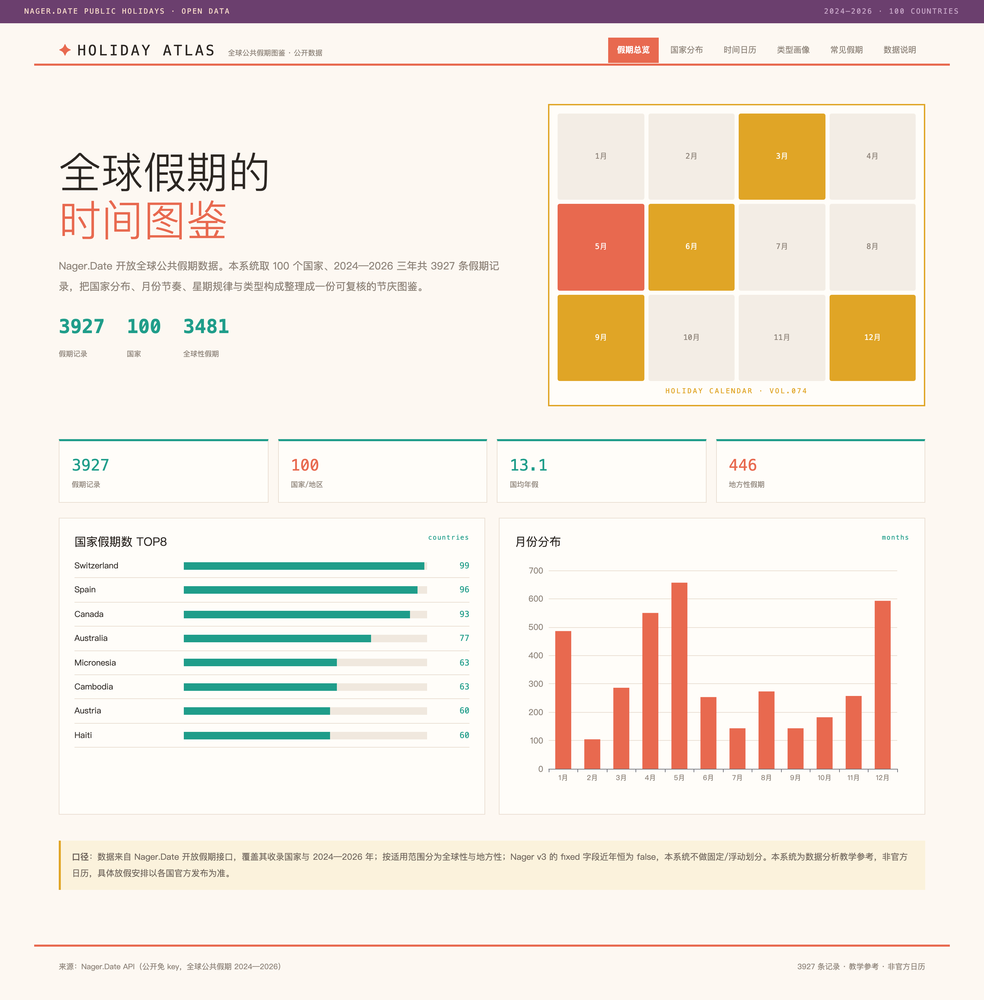
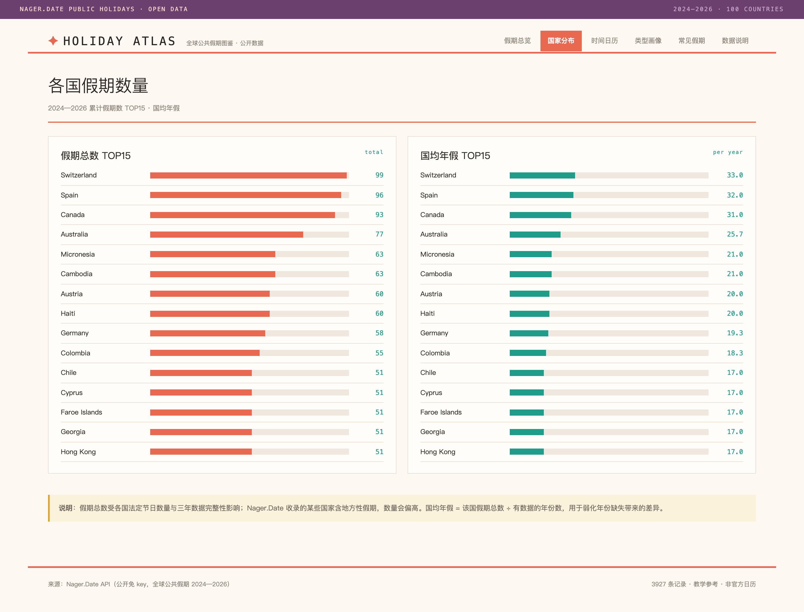
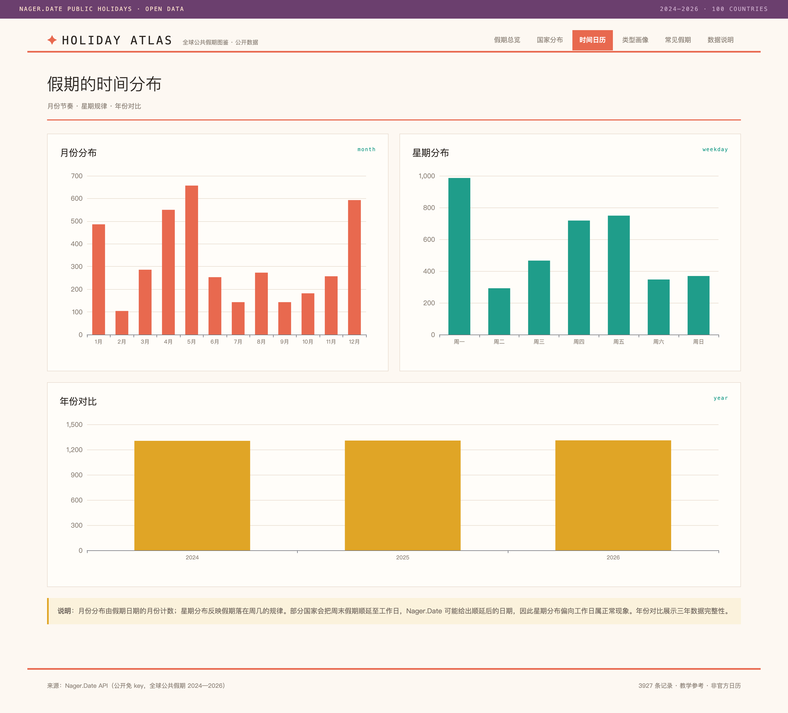
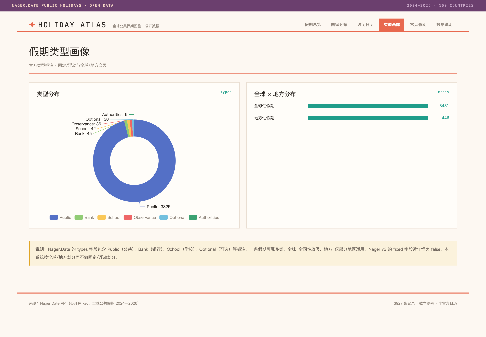
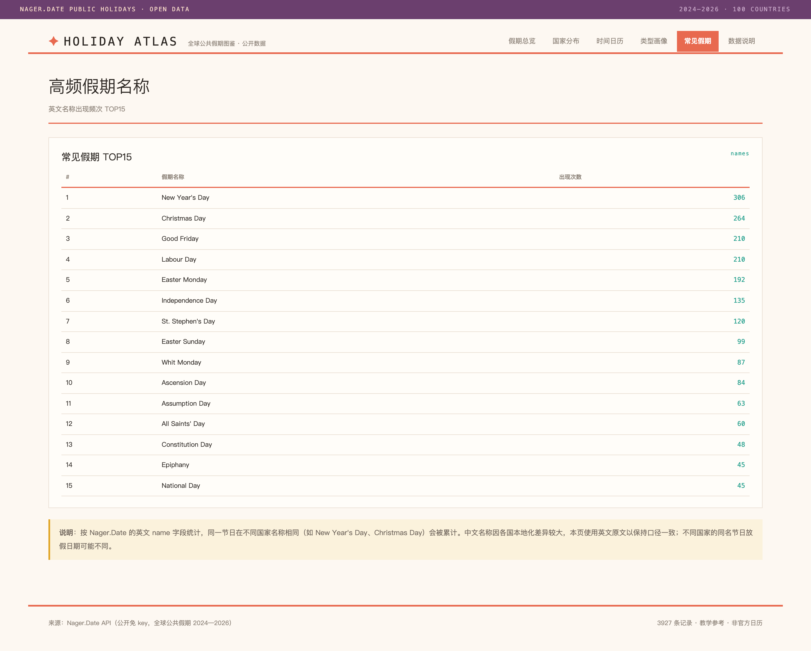
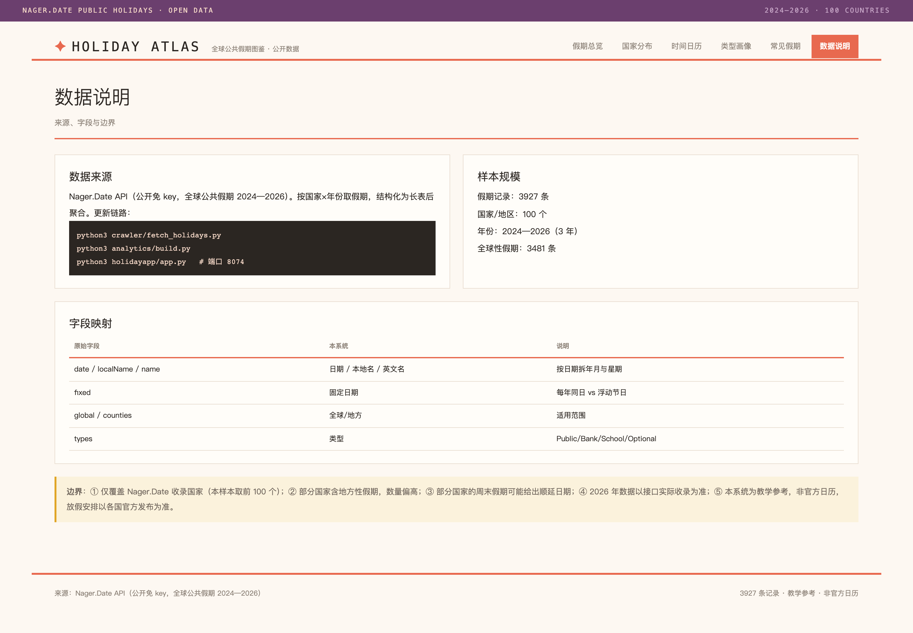

# 074 基于Nager-Date公开数据的全球公共假期分析系统-设计展示

> **代码有偿获取 可接受定制 微信联系方式: csbysj2020 或 ACE2487，备注(BS)**

> **完整源码与全套文档 · 在线自助获取 >>> [https://mbd.pub/o/bread/YZaWmJpubQ==](https://mbd.pub/o/bread/YZaWmJpubQ==)**

> **成品页（功能介绍 / 更多选题）>>> [https://bishe.suilang.net/products/holiday-atlas](https://bishe.suilang.net/products/holiday-atlas)**

> 

> 

## 视频

> **点击查看 >>> [https://www.bilibili.com/video/BV13ky8zwEw9/](https://www.bilibili.com/video/BV13ky8zwEw9/)**

## 项目简介

环球节庆日历风格（暖珊瑚、青绿、金黄、日历格子），区别于太阳观测台/航班信息屏/深空雷达。采集 Nager.Date 公开假期 3927 条（100 国 × 2024—2026），从国家、月份星期、类型与适用范围四维分析。Flask + ECharts（本地化离线可用），6 个页面。接口字段可用性与地方假期口径如实标注，非官方日历。

公共假期是观察各国文化传统与制度安排的数据窗口。

本项目设计并实现了一套基于 Nager.Date 公开数据的全球公共假期分析系统：通过 API 按 100 个国家 × 2024—2026 三年采集 3927 条假期记录，结构化后从国家分布、月份与星期节奏、类型构成、适用范围与常见节日五个维度聚合分析。

系统采用 Flask + ECharts 与环球节庆日历式界面（暖珊瑚、青绿、金黄、日历格子），实现假期总览、国家分布、时间日历、类型画像、常见假期、数据说明 6 个页面。

本仓库为**设计展示**：包含项目说明、技术架构、实验结果与运行截图；完整源码、任务书、开题报告、毕业论文与使用说明可通过上方链接自助获取，成品页可查看更多选题，也可联系微信咨询定制。

## 功能特性

1. 差异化视觉：节庆日历（暖珊瑚/青绿/金黄/日历格子），非看板/画廊/雷达/信息屏

2. 真实采集：Nager.Date API 公开免 key，3927 条假期记录

3. 多国多年度：100 个国家 × 2024—2026

4. 时间节奏：月份与星期分布，假期在 5月 最集中

5. 类型画像：Public 为主，多值拆分；全球性 3481 条

6. 常见假期：英文名称频次 TOP15

7. 技术栈差异化：Flask + ECharts（本地化）

8. 合规边界：收录国家有限、地方假期与周末顺延、非官方日历

## 技术架构

| 项目 | 说明 |
| --- | --- |
| 编程语言 | Python 3.8+ |
| Web 框架 | Flask（轻量路由，无 ORM） |
| 图表 | ECharts（本地化离线可用） |
| 数据源 | Nager.Date API（公开免 key） |
| 样本规模 | 3927 记录 / 100 国家 / 3 年 |
| 运行端口 | http://127.0.0.1:8074 |
| 说明 | 数据直读 analysis JSON，无需数据库 |

## 目录结构

以下为完整交付版的结构（本仓库仅作设计展示）：

```
holiday-atlas/
├── analytics/
│   └── build.py
├── crawler/
│   └── fetch_holidays.py
├── data/
│   ├── analysis/
│   │   ├── countries.json
│   │   ├── fixed_global.json
│   │   ├── months.json
│   │   ├── per_country.json
│   │   ├── top_names.json
│   │   ├── types.json
│   │   ├── weekdays.json
│   │   └── years.json
│   ├── processed/
│   │   └── holidays.csv
│   └── stats.json
├── holidayapp/
│   └── app.py
├── static/
│   ├── css/
│   │   └── style.css
│   └── vendor/
│       └── echarts.min.js
├── templates/
│   ├── about.html
│   ├── base.html
│   ├── calendar.html
│   ├── countries.html
│   ├── names.html
│   ├── overview.html
│   └── types.html
├── 任务书/
│   └── 毕业设计任务书.docx
├── 开题报告/
│   └── 毕业设计开题报告.docx
├── 最终论文/
│   ├── 图/
│   │   └── fig-arch.png
│   └── 基于Nager-Date公开数据的全球公共假期分析系统设计与实现.docx
├── 演示截图/
│   ├── 074-01-overview.png
│   └── …
└── …
```

## 数据与实验结论

- 实验显示样本覆盖 100 个国家，国均年假 13.1 天，3481 条为全球性假期，假期在 5月 最为集中。
- 真实采集：Nager.Date API 公开免 key，3927 条假期记录
- 多国多年度：100 个国家 × 2024—2026
- 时间节奏：月份与星期分布，假期在 5月 最集中

## 交付内容

1. 完整源码（Flask 应用 + 采集器 + 分析引擎 + 6 页面）
2. 真实数据（holidays.csv + analysis JSON）
3. 任务书与开题报告（Word）
4. 毕业论文（Word 七章制）
5. 二次开发说明（Word+md）
6. 6 张截图 + 封面 + 演示视频

## 常见问题

**为什么瑞士假期特别多？**

其数据含较多地方性假期，接口按记录计，数量会偏高。

**固定/浮动怎么划分？**

Nager v3 的 fixed 字段近年恒为 false，本系统按全球性/地方性统计。

**星期分布为什么偏工作日？**

部分国家把周末假期顺延至工作日，接口给出顺延后日期。

**图表能离线用吗？**

能，echarts.min.js 已本地化到 static/vendor/。

## 截图







